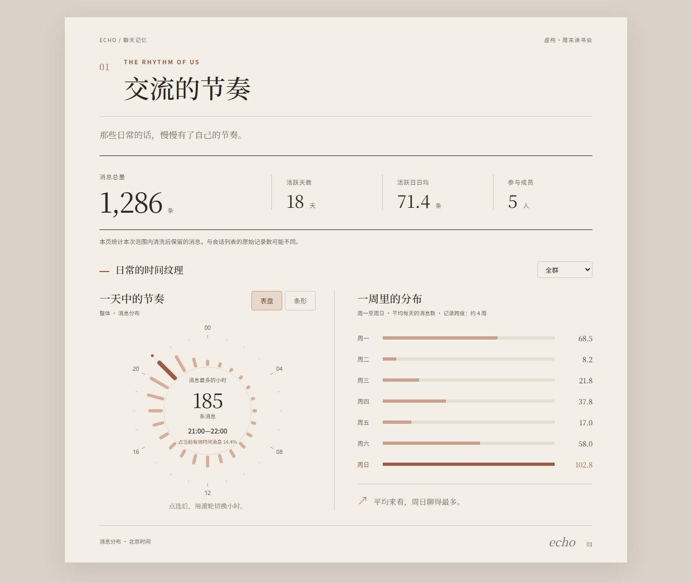
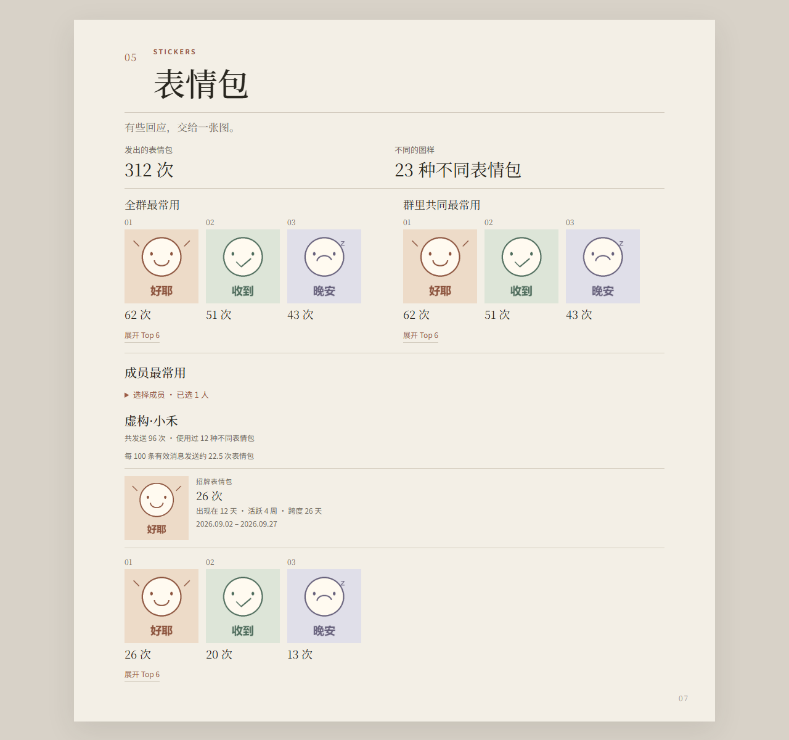

# 余音 Echo

**每一句聊天，都会留下余音。**

Echo 是一款支持 **QQ / 微信** 的 Windows 本地聊天分析工具。连接聊天来源，选择一段会话，把聊天节奏、表达习惯和常用表情包整理成可以慢慢回看的 **Echo Report**。

**[⬇ 国内下载 Windows 安装包（v0.3.6）](https://cnb.cool/echo_mly/echo_releases/-/releases/download/v0.3.6/Echo-0.3.6-windows-x64-Setup.exe)** · [GitHub 备用直链](https://github.com/lindreams/echo-chat-analyzer/releases/download/v0.3.6/Echo-0.3.6-windows-x64-Setup.exe) · [版本说明](https://github.com/lindreams/echo-chat-analyzer/releases/tag/v0.3.6) · [反馈问题](https://github.com/lindreams/echo-chat-analyzer/issues/new/choose)

**只支持 Windows 64 位电脑，暂不支持手机端。** 需要电脑端 QQ / 微信已经保存了相应的本地聊天记录；无法直接分析只存在手机里的历史记录。

**免费、开源，下载安装无需编程基础。** 不需要安装 Python、下载源码或配置开发环境。

*v0.2.4 界面演示，使用虚构数据。*

## 在报告里看见什么

- **交流的节奏**：消息数量、活跃情况，以及一天和一周里的聊天分布。
- **每次聊起**：谁更常开启聊天、下一段从几点开始，以及群聊的热闹集中在哪里；私聊展示微信拍一拍和 QQ 戳一戳的双方次数与个性化文案。
- **语言画像**：群聊成员及私聊双方的常用表达；点词查看原话，按需展开前后几句。
- **表情习惯**：Emoji 和已支持的 QQ / 微信表情使用情况。
- **表情包里的故事**：常用与共同常用的表情包，以及有记录支撑的招牌、接力、先后采用和流行变化。

部分发现需要足够记录才会展示；表情包图片无法取得时，仍保留统计和排名。
会话列表和报告中的成员查找同时支持备注、昵称及可用的群名片；同一个人可用任一名称找到，同名成员仍分别保留。群聊的交流节奏、语言画像和表达文化也支持成员排序。

*v0.2.4 界面演示，数据与表情包素材均为虚构。*

## 开始使用

**连接 QQ / 微信 → 选择会话与时间范围 → 生成报告 → 阅读或分享**

1. 点击顶部的 **国内下载** 链接，下载并运行 `Echo-0.3.6-windows-x64-Setup.exe`，按照安装提示操作。
2. 打开 Echo，选择 QQ 或微信，按当前页面的提示完成连接。
3. 选择聊天会话和时间范围，生成报告；报告可以在本机查看，也可以自行分享。

**下载哪个文件？** 普通用户只需要上面的 `Setup.exe` 安装包。发布页里的 `.nupkg`、`.json` 和 `.sha256` 不是普通用户需要安装的文件。

### 连接 QQ

使用 QQ 9.9.37（54395）。首次使用或很久没有在这台电脑登录时，请先在 QQ 中确认目标会话的历史消息已加载。
如果启用了 QQ 自动登录，请先关闭它。

1. 在 Echo 点「连接 QQ」。如果找到多个账号，选择本次要读取的账号资料。
2. Echo 提示打开 QQ 后，停在 QQ 登录界面。等 Echo 提示可以登录，再在 QQ 客户端登录所选账号。
3. Echo 提示退出 QQ 后，从任务栏右下角的 QQ 图标退出。Echo 会自动读取本机记录并加载会话。

需要手动指定资料位置时，可将 QQ「存储管理」中的保存路径粘贴到 Echo 连接页。

一次连接可以连续生成多个群聊和私聊报告。连接期间请保持 QQ 关闭。要恢复使用 QQ，点「退出连接」，等 Echo 提示连接已结束后再打开 QQ。

会话列表就绪后，连续 10 分钟没有查询会话时间范围或分析，Echo 会自动结束连接。成功查询时间范围或完成分析后重新计时。
仅搜索、排序或阅读报告不会续时，分析期间连接不会因闲置中断。自动结束后可以打开 QQ，也可以在 Echo 点「重新连接」继续生成报告。
已保存的报告可以随时在「本地数据」中打开。

报告中的「本人」按本次所选账号资料标记，QQ 在线登录身份没有单独认证。

*较早版本的操作界面，使用虚构会话。*

Windows 提示“无法识别的应用”怎么办？

Echo 是较新的个人开发软件，Windows SmartScreen 可能因应用信誉不足提示“Windows 已保护你的电脑”或“无法识别的应用”。先核对安装文件名和下载来源。如果确认来自上面的项目官方链接，并且只有 SmartScreen 的未知应用提示，可以选择“更多信息”后决定是否“仍要运行”。

**如果安全软件明确报告病毒或木马，或下载来源不确定，请先停止安装，不要关闭安全防护或添加白名单。** 可以通过下方反馈入口询问。

查看 Echo 桌面首页

## 把聊天留作纪念

报告保存在本机，可从 Echo 中重新打开，也可用浏览器打开报告目录中的 `echo-report.html`。

你可以将整个报告目录复制或压缩后，作为文件分享给曾经一起聊天的人。词语原话和邻近上下文也会随报告一起分享；发送前请检查其中的昵称、聊天内容、表情包及其他个人信息。

## 隐私与联网

聊天数据的读取、分析和报告保存均在本机完成，不上传聊天数据进行分析。

- **QQ 图片与表情包素材**：生成报告时，Echo 查找所选账号已有的本地缓存，并可能通过 QQ 表情素材地址补取本次报告所需的少量商城表情。这个过程可以在 QQ 关闭时完成。
- **微信表情包素材**：可能向微信官方素材域名请求报告选定的少量素材，仅使用经过地址校验、并重新校验内容摘要的素材；不获取整段会话的全部图片。不需要联网补取素材时，可断网生成微信报告。
- **软件更新**：检查和下载更新需要联网，新版使用官方 CNB 分发仓库，无需登录 CNB。

素材获取失败时仍保留统计和排名。本地报告可随时重新打开或删除。

## 版本、更新与反馈

**当前可下载的正式版为 v0.3.6（2026-11-19）**。该版直接读取 QQ 本机记录，省去整库复制。源码后续调整的验证状态见 [维护状态](docs/HARDENING.md)。

个别大群分析仍可能短暂卡顿，过深的 Windows 报告输出路径仍有限制。

[查看 v0.3.6 更新说明](https://github.com/lindreams/echo-chat-analyzer/releases/tag/v0.3.6) · [查看全部版本](https://cnb.cool/echo_mly/echo_releases/-/releases) · [后续开发计划](docs/ROADMAP.md)

已安装用户如何更新？

**0.2.5 及更早版本请先手动下载新版 Setup，关闭 Echo 后运行一次。** 旧客户端固定使用 GitHub，无法通过 CNB 自动改写更新地址。

安装新版后，后续 Setup 版可在软件内检查和下载更新。请重新启动 Echo，在本次启动尚未连接 QQ / 微信、且没有分析任务时安装更新。经用户确认、更新包校验与安全清理通过后，软件才会安装并重启；若更新被拒绝，可重新启动后再试，或手动下载安装包。

v0.1.0 的 Portable ZIP 无法通过软件内更新升级，请手动安装 Setup。历史 ZIP 仍保留。本地报告与配置独立于程序目录保存；卸载时可保留报告和普通设置，或清除 Echo 本地数据，两种选择都会清除已保存的连接凭据、受管理的工作副本和临时数据。另存报告与自定义 QQ／微信目录不受影响；旧配置和运行路径的自动迁移尚未全面验证。

Release 中的 `.nupkg` 和更新索引供软件更新使用，SHA256 文件用于核对下载。CNB 负责国内分发，[项目源码](https://github.com/lindreams/echo-chat-analyzer) 维护在 GitHub。

连接、读取或生成报告失败时如何反馈？

[提交问题反馈](https://github.com/lindreams/echo-chat-analyzer/issues/new/choose)，请说明 Echo 版本、Windows 版本、QQ / 微信及私聊 / 群聊、发生时间、操作步骤和错误提示。暂时无法安全脱敏时，只描述现象即可。

日志保存在 `%LOCALAPPDATA%\LocalChatAnalyzer\logs`。QQ 问题可在再次尝试前，将同一次运行的 `echo.log` 和 `qq-snapshot-diagnostics.log` 完整复制到本机保留，避免后续运行覆盖排查线索。

**GitHub Issue 是公开的。请勿上传原始日志、真实聊天记录、数据库、原始报告或未经脱敏的截图。** 如需补充诊断，只提供检查后的错误信息或必要的脱敏片段，不公开群号、昵称、账号、密钥或真实本机路径。

## 开源与开发

- [开发指南](DEVELOPMENT.md) · [项目架构](ARCHITECTURE.md)
- [维护状态](docs/HARDENING.md) · [产品路线图](docs/ROADMAP.md)
- [MPL 2.0 开源许可](LICENSE) · [许可声明](NOTICE.md) · [第三方许可](third_party/napcat/NOTICE.md)

Echo 自有且有权授权的源码采用 MPL 2.0。官方 Echo 免费、非商业运营，第三方组件遵循各自许可证。
MPL 2.0 不覆盖第三方图片；QQ 表情图片的再分发与修改授权仍待确认，详见 [许可声明](NOTICE.md)。
