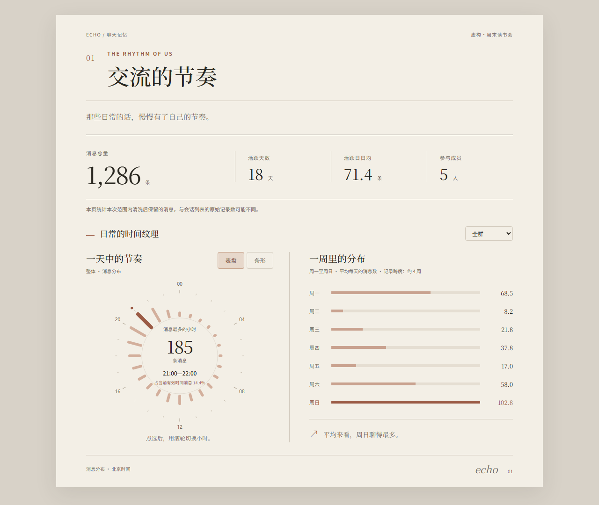
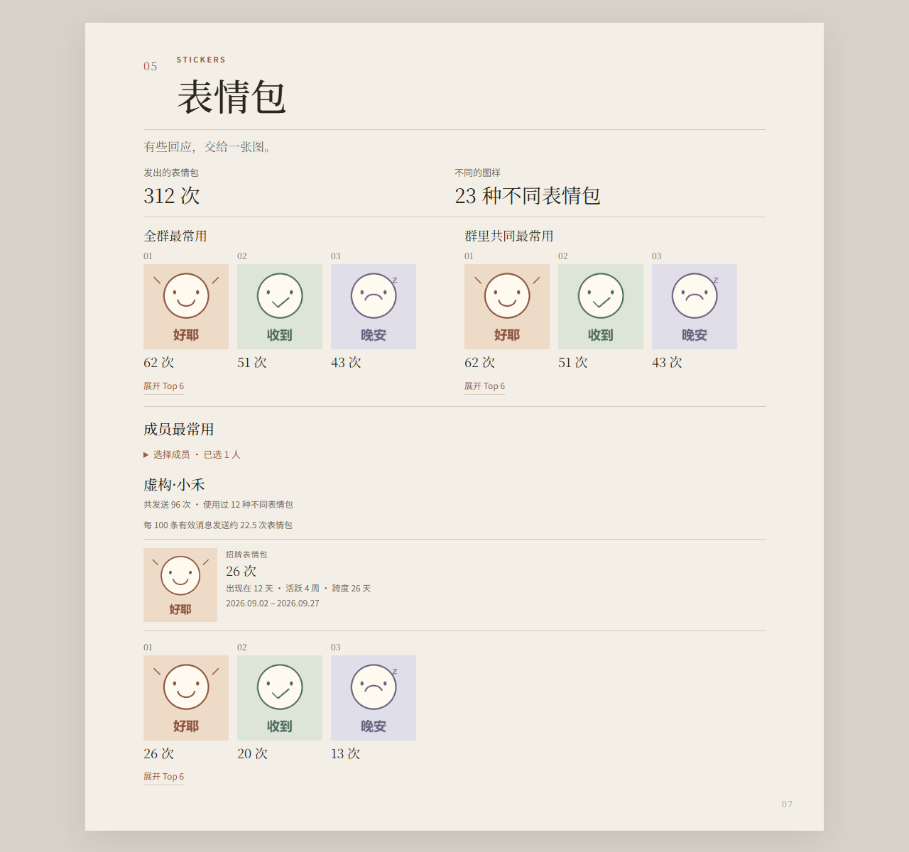

# 余音 Echo

**每一句聊天，都会留下余音。**

Echo 是一款支持 **QQ / 微信** 的 Windows 本地聊天分析工具。连接聊天来源，选择一段会话，把聊天节奏、表达习惯和常用表情包整理成可以慢慢回看的 **Echo Report**。

**[下载 Windows x64 安装版](https://cnb.cool/echo_mly/echo_releases/-/releases/download/v0.3.0/Echo-0.3.0-windows-x64-Setup.exe)** · [查看版本说明](https://cnb.cool/echo_mly/echo_releases/-/releases/tag/v0.3.0) · [反馈问题](https://github.com/lindreams/echo-chat-analyzer/issues/new/choose)

当前版本为 **v0.3.0**。无需安装 Python。

*v0.2.4 界面演示，使用虚构数据。*

## 在报告里看见什么

- **交流的节奏**：消息数量、活跃情况，以及一天和一周里的聊天分布。
- **每次聊起**：谁更常开启聊天、下一段从几点开始，以及群聊的热闹集中在哪里；私聊展示微信拍一拍和 QQ 戳一戳的双方次数与个性化文案。
- **语言画像**：群聊成员及私聊双方的常用表达；点词查看原话，按需展开前后几句。
- **表情习惯**：Emoji 和已支持的 QQ / 微信表情使用情况。
- **表情包里的故事**：常用与共同常用的表情包，以及有记录支撑的招牌、接力、先后采用和流行变化。

部分发现需要足够记录才会展示；表情包图片无法取得时，仍保留统计和排名。
群聊的交流节奏、语言画像和表达文化支持成员排序与昵称、备注、群名片查找。

*v0.2.4 界面演示，数据与表情包素材均为虚构。*

## 开始使用

**连接 QQ / 微信 → 选择会话与时间范围 → 生成报告 → 阅读或分享**

1. 下载并运行 `Echo-0.3.0-windows-x64-Setup.exe`，完成安装。
2. 在 Echo 中选择 QQ 或微信，按提示完成连接与授权。
3. 选择会话和时间范围，生成回顾报告。

*使用虚构会话展示操作界面。*

首次使用或很久没有在这台电脑登录时，QQ 本机历史记录可能不完整。请先在 QQ 中确认目标会话的历史消息已加载，再回到 Echo 生成报告。

查看 Echo 桌面首页

## 把聊天留作纪念

报告保存在本机，可从 Echo 中重新打开，也可用浏览器打开报告目录中的 `echo-report.html`。

你可以将整个报告目录复制或压缩后，作为文件分享给曾经一起聊天的人。词语原话和邻近上下文也会随报告一起分享；发送前请检查其中的昵称、聊天内容、表情包及其他个人信息。

## 隐私与联网

聊天数据的读取、分析和报告保存均在本机完成，不上传聊天数据进行分析。

- **QQ 表情包素材**：生成报告时，Echo 可能通过已登录的 QQ 客户端自动获取本次报告所需的少量素材，无需另行确认；不进行无关会话的后台批量获取。
- **微信表情包素材**：可能向微信官方素材域名请求报告选定的少量素材，仅使用经过地址校验、并重新校验内容摘要的素材；不获取整段会话的全部图片。不需要联网补取素材时，可断网生成微信报告。
- **软件更新**：检查和下载更新需要联网，新版使用官方 CNB 分发仓库，无需登录 CNB。

素材获取失败时仍保留统计和排名。本地报告可随时重新打开或删除。

## 版本、更新与反馈

v0.3.0 收口表情包分析与报告展示：个人发现归入对应成员，同类记录可前后翻看；收紧聊天轮次、语言及表情排行中的重复信息。私聊拍一拍／戳一戳仅展示双方次数，支持已确认来源中的个性化文案，两侧次数对齐。卸载新增保留报告和普通设置、或清除 Echo 本地数据的选择。此前的词语原话查看、成员查找、素材无损去重及 QQ 素材队列优化均保留。

**群聊独立“回复关系”章节延期到 0.4.0，本版不包含该原型。** 旧报告需要重新生成，才能显示新版内容；表情章节的整体篇幅调整留到后续版本。

不同电脑与 QQ / 微信版本的兼容性仍在收集反馈。

[查看发布说明与所有下载文件](https://cnb.cool/echo_mly/echo_releases/-/releases/tag/v0.3.0) · [查看所有版本](https://cnb.cool/echo_mly/echo_releases/-/releases) · [后续开发计划](docs/ROADMAP.md)

已安装用户如何更新？

**0.2.5 及更早版本请先手动下载新版 Setup，关闭 Echo 后运行一次。** 旧客户端固定使用 GitHub，无法通过 CNB 自动改写更新地址。

安装新版后，后续 Setup 版可在软件内检查和下载更新。请重新启动 Echo，在本次启动尚未连接 QQ / 微信、且没有分析任务时安装更新。经用户确认、更新包校验与安全清理通过后，软件才会安装并重启；若更新被拒绝，可重新启动后再试，或手动下载安装包。

v0.1.0 的 Portable ZIP 无法通过软件内更新升级，请手动安装 Setup。历史 ZIP 仍保留。本地报告与配置独立于程序目录保存；卸载时可保留报告和普通设置，或清除 Echo 本地数据，两种选择都会清除已保存的连接凭据、受管理的工作副本和临时数据。另存报告与自定义 QQ／微信目录不受影响；旧配置和运行路径的自动迁移尚未全面验证。

普通用户只需下载 `Setup.exe`。Release 中的 `.nupkg` 和更新索引供软件更新使用，SHA256 文件用于核对下载。CNB 仓库仅负责分发；[项目源码](https://github.com/lindreams/echo-chat-analyzer) 继续维护在 GitHub。

连接、读取或生成报告失败时如何反馈？

[提交问题反馈](https://github.com/lindreams/echo-chat-analyzer/issues/new/choose)，请说明 Echo 版本、Windows 版本、QQ / 微信及私聊 / 群聊、发生时间、操作步骤和错误提示。暂时无法安全脱敏时，只描述现象即可。

日志保存在 `%LOCALAPPDATA%\LocalChatAnalyzer\logs`。QQ 问题可在再次尝试前，将同一次运行的 `echo.log` 和 `qq-snapshot-diagnostics.log` 完整复制到本机保留，避免后续运行覆盖排查线索。

**GitHub Issue 是公开的。请勿上传原始日志、真实聊天记录、数据库、原始报告或未经脱敏的截图。** 如需补充诊断，只提供检查后的错误信息或必要的脱敏片段，不公开群号、昵称、账号、密钥或真实本机路径。

## 开源与开发

- [开发指南](DEVELOPMENT.md) · [项目架构](ARCHITECTURE.md)
- [维护状态](docs/HARDENING.md) · [产品路线图](docs/ROADMAP.md)
- [MPL 2.0 开源许可](LICENSE) · [许可声明](NOTICE.md) · [第三方许可](third_party/napcat/NOTICE.md)

Echo 自有且有权授权的源码采用 MPL 2.0。官方 Echo 免费、非商业运营，第三方组件遵循各自许可证。
MPL 2.0 不覆盖第三方图片；QQ 表情图片的再分发与修改授权仍待确认，详见 [许可声明](NOTICE.md)。
